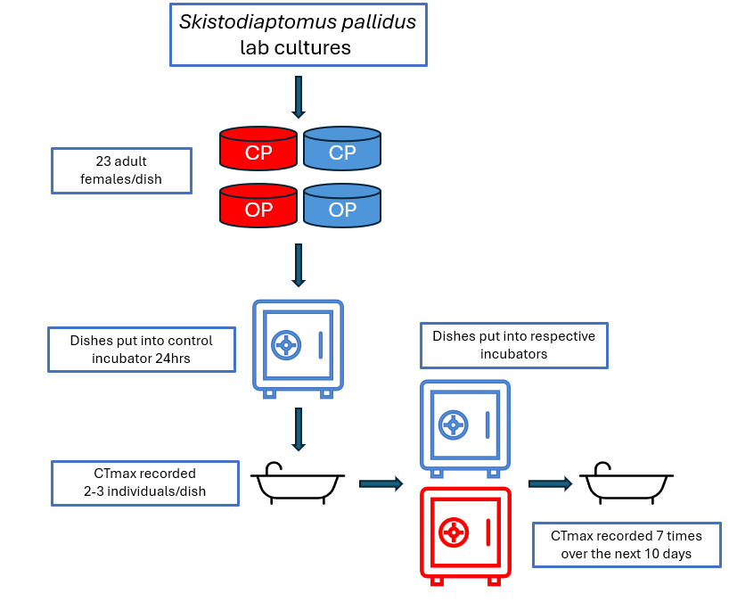

```{r}
#| label: logos
#| echo: false
#| output: asis
# ---- Logos ------------------------------------------------------------------
# A GitHub link (".../blob/..." page link or raw link), a path to a local PNG,
# or NA for no logo. Downloads go into Quarto's temporary render folder, which
# is deleted after the PDF is made, so nothing is saved next to this file.

library(tidyverse)

logos <- c(
  left  = "https://raw.githubusercontent.com/ZoopEcoEvo/lab_utilities/main/lab_logos/text_logo_white.png",
  right = "https://raw.githubusercontent.com/ZoopEcoEvo/lab_utilities/refs/heads/main/lab_logos/UML_Biology_Logo_White.png"
)

tmp_dir <- dirname(paste0(knitr::opts_chunk$get("fig.path"), "x"))  # Quarto's figure folder
dir.create(tmp_dir, recursive = TRUE, showWarnings = FALSE)
token <- Sys.getenv("GITHUB_PAT")

cat("```{=typst}\n")
for (side in names(logos)) {
  src <- gsub("&#58;", ":", logos[[side]], fixed = TRUE)  # undo the visual editor's escaped colon
  path <- NA
  if (!is.na(src) && grepl("^https?://", src)) {
    url  <- sub("^https://github.com/([^/]+/[^/]+)/blob/", "https://raw.githubusercontent.com/\\1/", src)
    dest <- file.path(tmp_dir, paste0("logo-", side, ".png"))
    ok <- tryCatch({
      download.file(url, dest, mode = "wb", quiet = TRUE,
                    headers = if (nzchar(token)) c(Authorization = paste("token", token)))
      identical(readBin(dest, "raw", 4), as.raw(c(0x89, 0x50, 0x4e, 0x47)))  # is it a PNG?
    }, error = function(e) FALSE, warning = function(w) FALSE)
    if (ok) path <- dest else message("Couldn't download ", url, "; leaving the ", side, " logo blank.")
  } else if (!is.na(src)) {
    path <- src  # local file
  }
  cat(sprintf("#metadata(%s) <poster-logo-%s>\n",
              if (is.na(path)) "none" else paste0('"', path, '"'), side))
}
cat("```\n")

```

# Introduction

- Heatwaves are projected to increase in duration and intensity by the end of the century

- Acclimation: Short-term and often reversible change in physiology

  - No genetic change required

- Temporal dynamics of acclimation defined by **capacity** and **rate of acclimation**

```{r acclim-schematic, out.width='100%', fig.align='center', fig.height=4}

acclim <- function(t, t_shift = 0, p0 = 1, capacity = 2, lambda = 0.25) {
  ifelse(t < t_shift,
         p0,
         p0 + capacity * (1 - exp(-lambda * (t - t_shift))))
}

t       <- seq(-6, 30, by = 0.05)
t_shift <- 0
p0      <- 1
cap     <- 2
lambda  <- 0.25
t_half  <- log(2) / lambda
p_half  <- p0 + cap / 2
p_final <- p0 + cap

# Colours
col_main <- "#1b4f72"
col_cap  <- "#c0392b"
col_rate <- "#d68910"
col_env  <- "grey30"

trait_df <- data.frame(time = t, trait = acclim(t, t_shift, p0, cap, lambda))

# Initial tangent: slope = lambda * C, reaches the asymptote at t = 1/lambda
tangent_df <- data.frame(x = t_shift, xend = t_shift + 1 / lambda,
                         y = p0, yend = p_final)

ggplot(trait_df, aes(time, trait)) +
  geom_vline(xintercept = t_shift, linetype = "dotted",
             colour = "grey60") +
  geom_hline(yintercept = c(p0, p_final), linetype = "dashed",
             colour = "grey55") +
  annotate("text", x = -6, y = p0 + 0.12, hjust = 0, size = 3.2,
           label = "Acclimated to env. 1") +
  annotate("text", x = 30, y = p_final + 0.12, hjust = 1, size = 3.2,
           label = "Acclimated to env. 2") +
  geom_segment(data = tangent_df,
               aes(x = x, xend = xend, y = y, yend = yend),
               inherit.aes = FALSE, linetype = "longdash",
               colour = col_rate, linewidth = 0.6) +
  geom_segment(aes(x = t_half, xend = t_half, y = p0 - 0.25, yend = p_half),
               linetype = "dotted", colour = col_rate) +
  geom_segment(aes(x = t_shift, xend = t_half, y = p0 - 0.25, yend = p0 - 0.25),
               colour = col_rate,
               arrow = grid::arrow(ends = "both", length = unit(1.5, "mm"))) +
  annotate("point", x = t_half, y = p_half, colour = col_rate, size = 2.5) +
  annotate("text", x = t_half / 2, y = p0 - 0.4, colour = col_rate,
           size = 3.5, label = "t½ = ln(2) / λ") +
  annotate("text", x = t_half + 1.2, y = p_half - 0.05, hjust = 0,
           colour = col_rate, size = 3.5, fontface = "bold",
           label = "Rate of acclimation (λ)") +
    annotate("segment", x = 27, xend = 27, y = p0, yend = p_final,
           colour = col_cap, linewidth = 0.8,
           arrow = grid::arrow(ends = "both", length = unit(2, "mm"))) +
  annotate("text", x = 27 - 0.6, y = p_half, hjust = 1,
           colour = col_cap, size = 3.5, fontface = "bold",
           label = "Capacity for\nacclimation (C)") +
    geom_line(linewidth = 1.2, colour = col_main) +
  scale_y_continuous(limits = c(p0 - 0.55, p_final + 0.3)) +
  labs(x = "Time since environmental change",
       y = "Physiological trait") +
  theme_classic(base_size = 18) +
  theme(
    axis.text  = element_blank(),
    axis.ticks = element_blank(),
    axis.line  = element_line(arrow = grid::arrow(length = unit(2, "mm"),
                                                  type = "closed")),
    plot.title = element_text(face = "bold", size = 12),
    legend.position = "bottom",
    legend.title = element_blank()
  )

```

- Minimal information on how these parameters vary across populations

\

# Central Question

Do acclimation parameters vary across populations?

\

## **Hypotheses**

1\. The acclimation capacity will be higher in the population with a higher average surface temperature.

2\. The acclimation capacity and rate of acclimation will have a negative relationship.



# Results

```{r message = F, warning = F, echo=F}

ctmax_data = read.csv("https://raw.githubusercontent.com/ZoopEcoEvo/Skisto_LARA/refs/heads/main/Output/Output_data/ctmax_data.csv")

acc_params = read.csv("https://raw.githubusercontent.com/ZoopEcoEvo/Skisto_LARA/refs/heads/main/Output/Output_data/acc_params.csv")

contrasts = read.csv("https://raw.githubusercontent.com/ZoopEcoEvo/Skisto_LARA/refs/heads/main/Output/Output_data/contrasts.csv")

library(tidyverse)

```

```{r ctmax-plot, out.width='90%', fig.align='center', fig.cap='CTmax (°C) over time (Acclimation hours) for the control (blue) and warming (red) treatments. The two populations are shown separately. Each point represents an individual copepods upper thermal limit. Logistic regressions are fit to each treatment group.', fig.height=4.1}


ctmax_data %>% 
  filter(ctmax > 34) %>% 
  mutate(acc_hours = acc_hours + 0.1) %>% 
  ggplot(aes(x = acc_hours, y = ctmax, colour = treatment)) + 
  facet_wrap(pop ~ .) +
  geom_point(size = 2) + 
  geom_smooth(method = "lm", formula = y ~ log(x)) + 
  scale_colour_manual(values = c("control" = "royalblue",
                                 "warming" = "brown2")) + 
  labs(
    x = "Acclimation Hour", 
    y = "CTmax (°C)"
  ) +
  theme_bw(base_size = 18) + 
  theme(
    legend.position = "bottom", 
    panel.grid = element_blank()
  )
```

```{r contrast-plot, out.width='90%', fig.align='center', fig.cap='Plot of the model contrasts (Warming - Control; °C) over time (Acclimation Day) for the two populations. The blue lines indicate the fitted acclimation equation based on the rate and capacity parameters.', fig.height=3.35}

param_data = contrasts %>%
  group_by(pop) %>% 
  arrange(acc_day) %>% 
  mutate(acc_day = if_else(acc_day == 0, 0.01, acc_day)) 

cp_params = filter(acc_params, pop == "CP")
op_params = filter(acc_params, pop == "OP")

# Create a new data frame with predicted values
acc_day <- seq(0, max(param_data$acc_day), length.out = 100)
cp_pred <- cp_params$z_asymp*(1-exp(-cp_params$lambda*acc_day))
op_pred <- op_params$z_asymp*(1-exp(-op_params$lambda*acc_day))

predictions = data.frame(acc_day, 
                         cp_pred, 
                         op_pred) %>% 
  pivot_longer(cols = c(cp_pred:op_pred), 
               names_to = c("pop", NA), 
               names_sep = "_", 
               values_to = "pred") %>% 
  mutate(pop = toupper(pop))

param_data %>% 
  drop_na(estimate) %>% 
  ggplot(aes(x = acc_day, y = estimate)) + 
  facet_wrap(pop~.) + 
  geom_hline(yintercept = 0) +
  geom_hline(data = acc_params, aes(yintercept = z_asymp),
             colour = "grey") + 
  geom_errorbar(aes(ymin = estimate - SE, ymax = estimate + SE), 
                linewidth = 1, width = 0.3) + 
  geom_point(size = 3) + 
  geom_line(data = predictions, aes(x = acc_day, y = pred),
            colour = "blue",
            linewidth=1.5)+
  labs(x = "Acc. Day", 
       y = "Change in CTmax (°C)") + 
  theme_bw(base_size = 18) + 
  theme(panel.grid = element_blank(), 
        legend.position = "bottom")

```



# Methods

{fig-align="center"}

# Conclusions

- *S. pallidus* is able to acclimate rapidly to warming.

- Populations differ in both capacity and acclimation, with a potental negative correlation between capacity and rate of acclimation.

# Next Steps

- Replicate with additional populations of *S. pallidus*

# Acknowledgements

This project was supported by the KCS Science Scholarship 2025 & 2026.
